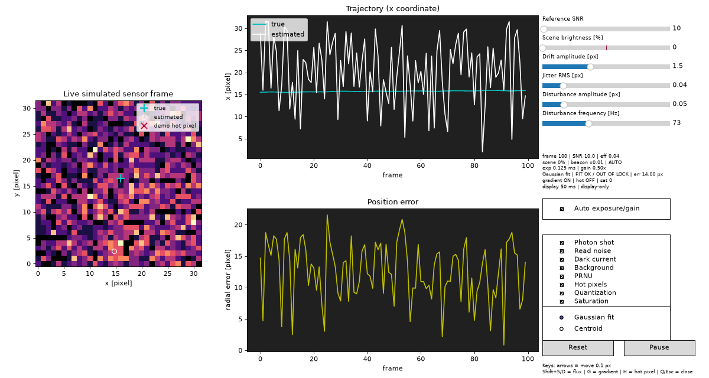

# Sub-pixel laser spot localization

Sub-pixel localization of a noisy laser beacon for a camera-guided pointing
and tracking system.

## Start here

Read the [technical report](report.md) or the [PDF version](report.pdf) first
for the methodology, assumptions, quantitative results, estimator comparison,
runtime analysis, dynamic recovery, and limitations.

## Setup

Create and activate a local Python virtual environment, then install the
dependencies:

```bash
python3 -m venv .venv
source .venv/bin/activate
python -m pip install -r requirements.txt
```

On Windows, activate the environment with `.venv\Scripts\activate` instead.

## Run the complete study

The recommended reproducible command is:

```bash
python run_all.py --config configs/final.yaml
```

This generates the static SNR characterization, theoretical precision
reference, ROI study, runtime benchmark, controlled estimator ablation,
dynamic trajectory/disturbance analysis, multi-seed amplitude repeat,
real-world stress analysis, figures, and a run manifest.

The newest results are copied to `results/latest/`. Timestamped copies are
retained under `results/runs/`.

Run the tests with:

```bash
python -m pytest -q
```

The current suite contains 43 tests.

## Design and implementation summary

- Pixel-integrated circular Gaussian spot model.
- Configurable photon, read, dark-current, background, PRNU, hot-pixel,
  quantization, and saturation effects.
- Background-subtracted windowed centroid.
- Bounded pixel-integrated Gaussian fit with an analytical Jacobian.
- Monte Carlo bias, precision, RMSE, failure, and lock-loss characterization
  versus SNR, with uncertainty bars.
- Controlled sensor-effect ablations explaining the clean/stressed estimator
  ranking reversal.
- Clean-model Fisher-information/CRLB reference.
- Runtime benchmark against a 1 ms / 1 kHz frame budget.
- Dynamic drift, correlated jitter, and periodic-disturbance recovery.
- Multi-seed disturbance-amplitude repeatability analysis.
- Controlled outdoor-condition stress analysis.
- Optional live GUI using the same simulator and estimators.

The centroid is the low-latency baseline. The Gaussian fit is generally more
accurate when the spot is observable, but is more computationally expensive
and can lose lock at very low SNR or under model mismatch.

## Key results

The values below are from the seeded final run in `results/latest/`; runtime
values are specific to the recorded development machine.

| Experiment | Key result | Interpretation |
|---|---|---|
| Static localization | At SNR 10, radial RMSE was 0.161 px for the centroid and 0.081 px for the Gaussian fit in the stressed profile. | The Gaussian fit improved accuracy when the spot remained observable. |
| Low-SNR lock loss | At SNR 1, stressed-profile lock loss was 96.5% for the centroid and 90.1% for the Gaussian fit. | Both methods become unreliable; failure accounting is essential. |
| Clean theoretical reference | The ideal-model radial precision reference was 0.0564 px at SNR 10. | The CRLB is a clean-model reference, not a universal bound for the stressed sensor. |
| Dynamic recovery | The 73 Hz disturbance was recovered within 0.007 Hz; 5,000-frame RMS tracking error was 0.164 px (centroid) and 0.082 px (Gaussian). | Both estimators recovered the injected periodic motion; the Gaussian fit gave lower error. |
| Runtime | Centroid median latency was 0.055 ms; the full Gaussian fit was 1.819 ms warm on the stressed profile. | The centroid is the Python low-latency baseline; Gaussian fitting is better suited to supervisory or compiled paths. |
| Saturation stress | At 100× nominal flux, centroid RMSE was 0.363 px versus 0.007 px for the clipped-pixel-masked Gaussian fit. | Saturation handling materially changes estimator behavior. |

See the report for uncertainty estimates, controlled ablations, assumptions,
failure modes, and the exact output paths for every result.


*Representative result: bias, precision, radial RMSE, and lock-loss behavior
across the SNR sweep for the stressed sensor profile.*

The primary `configs/final.yaml` keeps the full-quality Gaussian settings. To
experiment with a faster tracking configuration, use
[`configs/fast_gaussian.yaml`](configs/fast_gaussian.yaml) with the runtime
benchmark:

```bash
python -m experiments.benchmark_runtime \
  --profile dynamic \
  --config configs/fast_gaussian.yaml \
  --sequence dynamic \
  --frames 200 \
  --warmup 20
```

This optional study changes the Gaussian ROI, IRLS pass count, optimizer
limit, and tracking initialization policy. It does not replace the primary
results generated by `run_all.py`.

## Key assumptions

- Sensor: 32×32 pixels, 1 ms exposure, nominal 1 kHz frame rate.
- Spot: circular Gaussian with an approximately 7-pixel 1/e² diameter,
  corresponding to sigma = 1.75 pixels.
- Brightness: controlled through total expected spot electrons; target SNR is
  converted to flux using a pixel-centred reference spot.
- Sensor model: 12-bit ADC, 1 electron/DN, 3-electron RMS read noise, PRNU,
  dark current, background gradients, and persistent hot pixels.
- Dynamic drift: bounded Ornstein–Uhlenbeck process with correlated jitter and
  one 73 Hz sinusoidal disturbance.
- Lock-loss analysis: finite estimates with radial error greater than 1 pixel
  are classified as out of lock.
- CRLB: a clean Poisson Fisher-information reference for the ideal model
  (with a configurable read-noise term, set to zero in the ideal run), not a
  universal bound for saturated, quantized, or contaminated sensor frames.

The decision log is in
[`docs/decisions.md`](docs/decisions.md). The original assignment is preserved
in [`docs/assignment_spec.md`](docs/assignment_spec.md), and the development
plan is in [`docs/plan.md`](docs/plan.md).

## Live demonstration

Launch the optional review GUI with:

```bash
python -m experiments.live_gui \
  --profile sensor \
  --snr 10
```

The GUI shows the simulated sensor frame, true and estimated positions,
trajectory history, and position error. It provides controls for SNR, motion,
noise effects, sensor effects, and estimator selection.

With the figure focused:

- Arrow keys: nudge the true position by 0.1 pixel.
- `Shift+S`: low-flux preset, SNR 1.
- `Shift+D`: high-flux preset, SNR 1000.
- `G`: toggle the background gradient.
- `H`: inject a persistent ROI-edge hot pixel for demonstration.
- `Q` or `Escape`: close the window.

Matplotlib's default keyboard shortcuts are disabled for this figure. The GUI
is a demonstration layer; its display timer is intentionally slower than 1
kHz. The offline benchmark and `run_all.py` outputs are the authoritative
results.



The animation uses the same production simulator and estimators as the batch
experiments. It is provided for an interactive review demonstration; the saved
figures and numerical outputs remain the authoritative results.

## Output locations

- Static characterization: `results/latest/results/final_ideal/` and
  `results/latest/results/final_sensor/`
- Theoretical reference: `results/latest/results/final_ideal/`
- Runtime benchmarks: `results/latest/results/runtime_ideal/` and
  `results/latest/results/runtime_sensor/`
- Dynamic trajectory and disturbance analysis:
  `results/latest/results/dynamic/`
- Outdoor stress analysis: `results/latest/results/real_world/`
- Estimator ablation: `results/latest/results/estimator_ablation/`
- Dynamic amplitude repeats: `results/latest/results/dynamic_repeats/`
- Optional Gaussian tracking speed study: `results/performance/`
- Figures: `results/latest/figures/`
- Reproduction metadata: `results/latest/run_manifest.json`

The simulator and estimators use `image[y, x]` array indexing and `(x, y)`
pixel-centre coordinates. All experiments use deterministic named random
streams derived from a master seed.
