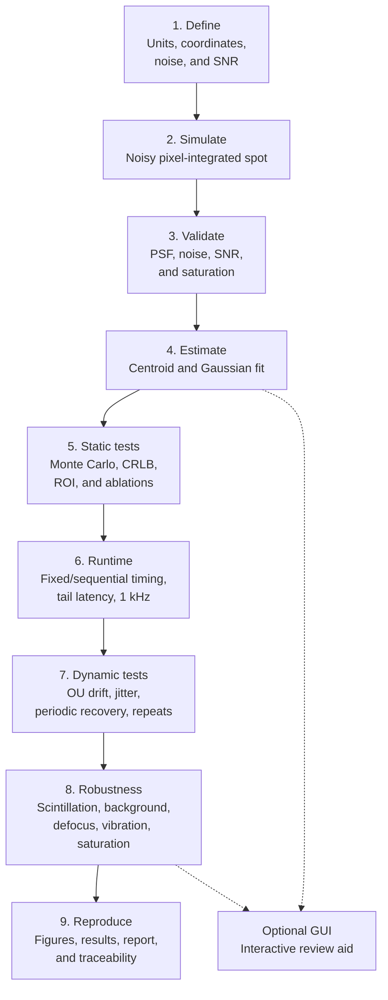

# Methodology flowchart

This is the high-level methodology for the project, rather than a literal
representation of every `run_all.py` stage. The exact reproducible execution
order and output paths are documented in Section 11.2 of the main report. The
detailed implementation choices, equations, assumptions, and validation checks
are documented in the main report and `plan.md`.

## What flows through the process

- **Input:** physical assumptions, sensor parameters, target SNR, and random seed.
- **Simulator output:** noisy frames plus the known true spot position.
- **Estimator output:** estimated sub-pixel position and quality information.
- **Static output:** bias, standard deviation, RMSE, failures, runtime, and comparison with the theoretical reference.
- **Dynamic output:** recovered trajectory and periodic disturbance frequency/amplitude.
- **Optional GUI output:** qualitative visual feedback for motion, noise, saturation,
  background, hot-pixel, and scene-brightness demonstrations. It is not an
  authoritative quantitative experiment.
- **Final output:** reproducible figures, machine-readable results, documented assumptions, and engineering conclusions.
