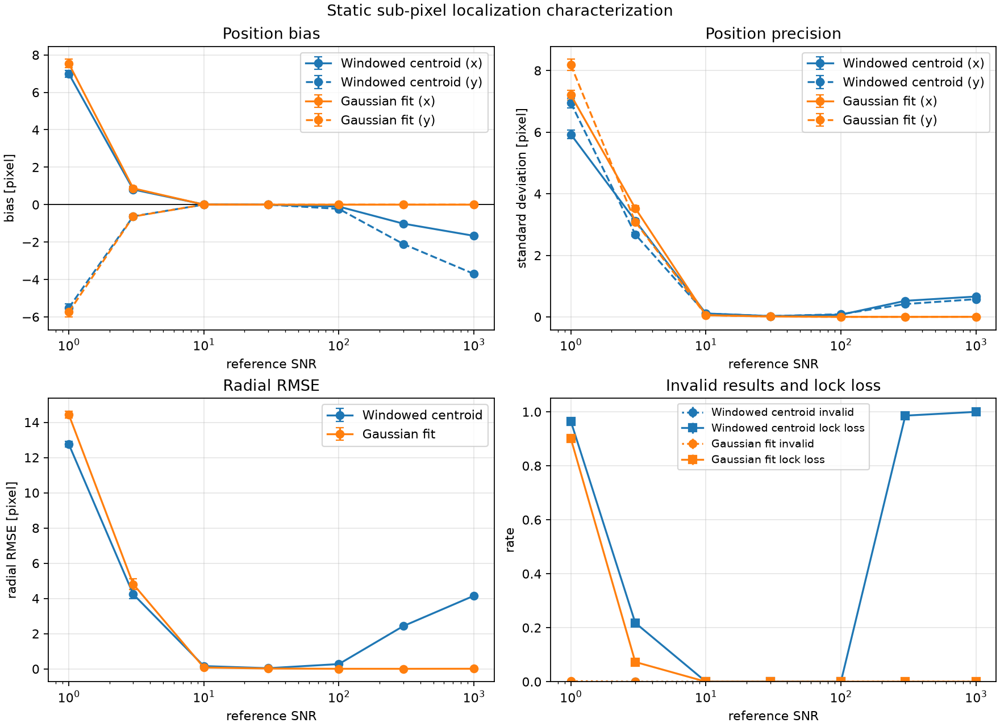
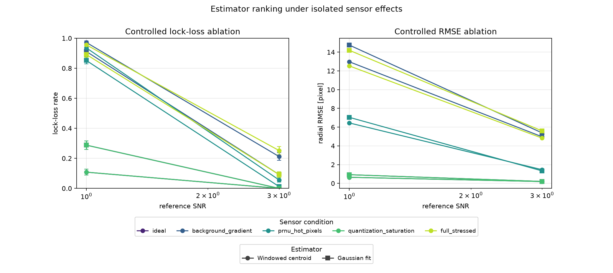
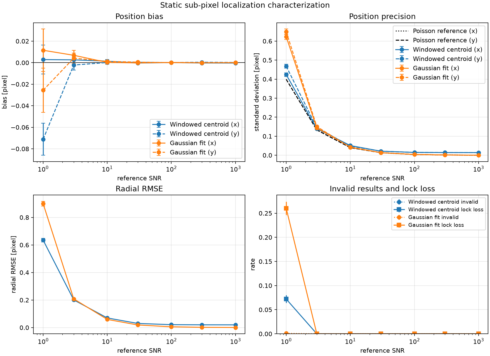
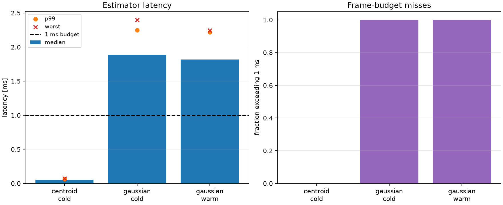
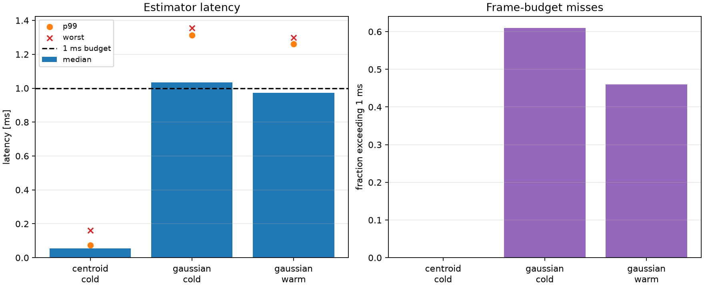
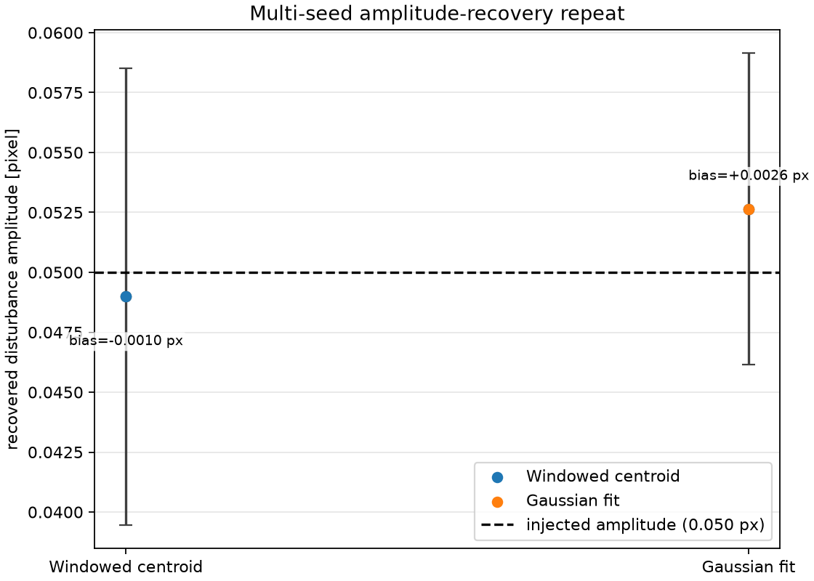
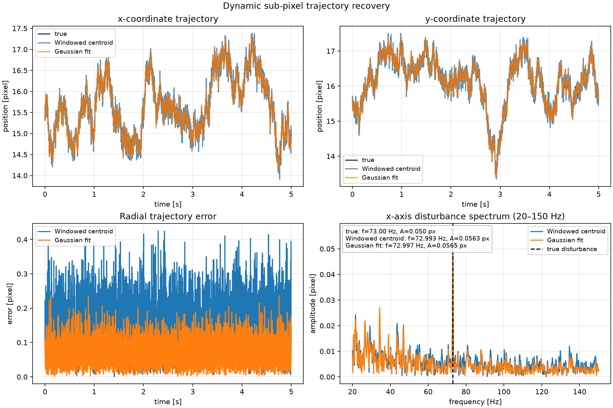
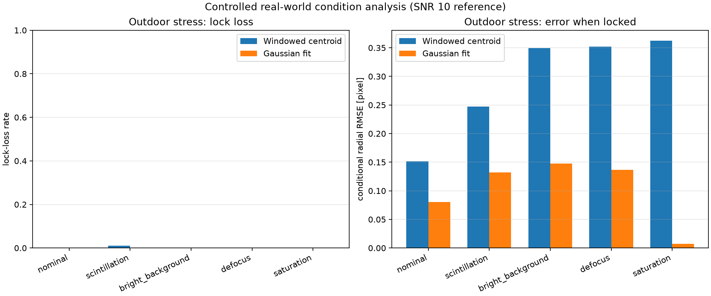
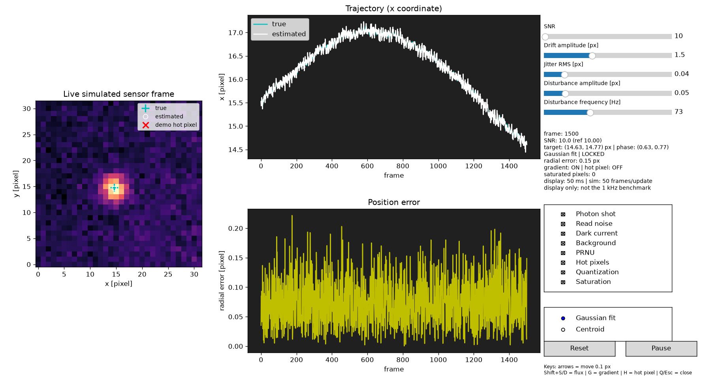

# Sub-pixel spot localization under sensor noise

## Abstract

This report describes a configurable simulation and estimation framework for
sub-pixel localization of a laser spot on a camera sensor. The work is a
simplified model of a camera-guided laser pointing system in which the spot
position must be estimated repeatedly at approximately 1 kHz. The simulator
uses a pixel-integrated circular Gaussian point-spread function and models
photon shot noise, read noise, dark current, hot pixels, background gradients,
pixel-response non-uniformity, quantization, and saturation.

Two estimators have been implemented: a windowed, background-subtracted
intensity centroid and a bounded pixel-integrated two-dimensional Gaussian
fit. The current implementation also includes a reproducible trajectory
generator, a static Monte Carlo characterization runner, and an optional live
visualization. At this checkpoint, the simulator, estimators, static
characterization, runtime benchmark, and dynamic recovery analysis have been
verified by 43 automated tests. The final `run_all.py` reproduction workflow
and real-world conditions analysis are complete. Runtime results
are treated as a Python development baseline rather than a flight-hardware
guarantee.

## 1. Introduction

The application considered in this exercise is a pair of camera-guided,
gimbal-mounted laser platforms. A camera observes the laser spot produced by
the opposing platform, and the measured spot position is supplied to a
stabilization loop. Platform vibration, optical variation, illumination, and
sensor noise make the measurement problem non-trivial. The objective of this
exercise is to evaluate the accuracy and computational cost of sub-pixel spot
localization under controlled simulated conditions.

The assignment requires four core elements: a configurable sensor simulator,
at least two localization estimators, Monte Carlo characterization as a
function of SNR, and per-frame runtime analysis. It additionally requires a
moving-spot experiment containing slow drift, random jitter, and one periodic
disturbance. The present report follows that structure. The complete
methodology is summarized in
[`docs/methodology_flowchart.md`](docs/methodology_flowchart.md).

## 2. Coordinate system and sensor model

### 2.1 Coordinate and unit conventions

Images are stored as `image[y, x]`. Cartesian spot positions are represented
as `(x, y)`. Pixel centers have integer coordinates, and pixel boundaries are
located half a pixel from the corresponding center. Charge quantities are
represented in electrons until conversion to analogue-to-digital units (DN).
The nominal sensor contains 32 × 32 pixels, has a 1 ms exposure, and operates
at a nominal frame rate of 1 kHz.

The spot width is specified using the assignment's approximately 7-pixel
diameter at the 1/e² intensity level. For

\[
I(r)=I_0\exp\left(-\frac{2r^2}{w^2}\right),
\]

the corresponding Gaussian standard deviation is \(\sigma=w/2\). Thus, a
7-pixel diameter gives a nominal \(\sigma=1.75\) pixels.

### 2.2 Pixel-integrated point-spread function

The expected spot image is generated by integrating a normalized circular
Gaussian over the finite area of each pixel. The separability of the Gaussian
allows the two-dimensional integral to be evaluated as the outer product of
two one-dimensional normal-CDF differences. This preserves sub-pixel phase
effects and avoids the bias that would result from evaluating the Gaussian at
pixel centers only.

The physical brightness parameter is the total expected spot charge,
\(N_{total}\), in electrons. The simulator also accepts a target SNR, which
is converted to \(N_{total}\) using a reference spot centered on a pixel.
Because the actual peak pixel depends on sub-pixel position and spot width,
each rendered frame records both the reference SNR and an effective SNR.

### 2.3 Sensor and noise model

The nominal stressed-sensor configuration uses a 12-bit ADC, 1 electron/DN
conversion gain, a 4095-electron full-well limit, and 3 electrons RMS read
noise. The background is a planar field with a 20-electron offset, an x
gradient of 0.25 electrons per pixel, and a y gradient of -0.15 electrons
per pixel. The default fixed-pattern model uses 1% PRNU, a 50-electron/s
baseline dark-current rate, and four hot pixels with a 5,000-electron/s
dark-current rate.

The sensor chain is applied in the following order:

1. generate expected spot, background, and dark-current charge;
2. apply a persistent multiplicative PRNU gain map;
3. sample the total expected charge using independent Poisson draws;
4. add independent Gaussian read noise in electrons;
5. combine the full-well and ADC limits into an equivalent charge limit and
   clip the charge in electrons;
6. convert the clipped charge from electrons to DN;
7. apply round-to-nearest quantization and the final DN-range clamp when
   enabled.

The conversion gain is explicit even though the nominal configuration uses
1 electron/DN, so the numerical DN and electron values coincide in the main
run. Full-well clipping and the ADC limit are both converted to an equivalent
charge limit before conversion. A unit test repeats this check with a
2-electron/DN gain and separate full-well and ADC limits; this prevents the
nominal 1-electron/DN choice from hiding a unit-ordering error.

The simulator's clipping mask records both high-side saturation and low-side
negative excursions from additive read noise before ADC conversion. In the
high-SNR dynamic result, the reported saturation behavior is dominated by
high-side spot clipping; low-side clipping is a separate readout artifact.

Photon noise, read noise, dark current, background, PRNU, and hot pixels can
be enabled independently through `NoiseConfig`. Quantization and saturation
are controlled through `SensorConfig`. Fixed-pattern maps persist for the
lifetime of a simulator and therefore persist across a dynamic sequence.

## 3. Localization estimators

Both estimators use the full image only to locate the brightest finite pixel.
They then operate on a local, odd-sized ROI and never use the simulator's true
position. The default centroid ROI is 13 × 13 pixels and the default Gaussian
fit ROI is 15 × 15 pixels.

### 3.1 Background-subtracted intensity centroid

The centroid estimator fits either a constant background or a plane to the
border of the local ROI:

\[
B(x,y)=b_0+b_x(x-c_x)+b_y(y-c_y).
\]

The fitted background is subtracted from the ROI, negative residuals are
clipped to zero, and the remaining intensities are used as weights:

\[
\hat{x}=\frac{\sum_i w_i x_i}{\sum_i w_i},\qquad
\hat{y}=\frac{\sum_i w_i y_i}{\sum_i w_i}.
\]

The estimator returns the position, ROI bounds, peak value, saturation flag,
positive signal, and fitted background coefficients. It returns an explicit
failure result when the image contains no usable signal rather than returning
an arbitrary bounded coordinate.

The centroid is computationally simple and interpretable. It is nevertheless
sensitive to background-model error, hot pixels, clipping, ROI truncation,
and the removal of faint PSF tails during background subtraction.

### 3.2 Pixel-integrated Gaussian fit

The second estimator fits the parameter vector

\[
\theta=(x_0,y_0,A,\sigma,b_0,b_x,b_y),
\]

where \(A\) is total spot flux in DN and the background is a local plane. The
spot contribution is integrated over each pixel using normal-CDF differences,
matching the simulator's forward model. Position, flux, and width are bounded
by configurable limits. Background coefficients remain unbounded.

The initial position is obtained from the centroid when available and from
the peak pixel otherwise. The fit uses bounded SciPy `least_squares` with an
analytical Jacobian. Two fixed iteratively reweighted steps approximate
Poisson-plus-read-noise weighting using

\[
V_i\approx\frac{\max(\mu_i,0)}{g}+\sigma_{r,DN}^2,
\]

where \(g\) is the electrons-per-DN conversion gain. A configurable 1 DN²
floor is applied to the first term before weighting, preventing tiny or
negative fitted tail-background values from receiving numerically dominant
weights. Pixels at the ADC limit
are excluded when saturation is enabled. The implementation records optimizer
cost, function evaluations, optimality, fitted width and flux, background
coefficients, valid-pixel count, and saturation count.

The fit retains an acquisition mode based on full-frame peak detection and a
tracking mode that can reuse the previous estimate to place the ROI. The
tracking mode can also skip the redundant centroid initialization. ROI size,
IRLS pass count, optimizer iteration limit, and these tracking choices are
configuration parameters rather than separate estimator implementations.

This method uses more information than the centroid and can estimate the
spot shape and background jointly. It is also more computationally expensive
and can fail under low SNR, poor initialization, saturation, or model
mismatch. It is therefore described as a noise-weighted nonlinear fit, or
quasi-MLE, rather than an exact likelihood for clipped and quantized data.

## 4. Verification of the current implementation

The current test suite contains 43 tests. The tests are deterministic and
use statistical tolerances where random sampling is involved. They cover:

- pixel-integrated PSF flux conservation and symmetry;
- sub-pixel position response and coordinate conventions;
- scenario and configuration validation;
- independent reproducibility of named random-number-generator streams;
- persistent PRNU, dark-current, and hot-pixel maps;
- Poisson and read-noise sample statistics;
- SNR-to-flux monotonicity and reference-SNR inversion;
- ADC quantization, clipping, and saturation invariants;
- independent noise-component ablations;
- background-gradient orientation and exposure scaling;
- composed Poisson/read-noise behavior and edge behavior;
- clean centroid and Gaussian-fit recovery;
- analytical Gaussian Jacobian agreement with finite differences;
- explicit failure on unusable frames;
- saturation handling in the Gaussian fit;
- reproducibility and bounds of the trajectory generator;
- headless rendering of one live-GUI update;
- characterization metrics, lock-loss classification, and the theoretical
  precision reference;
- runtime benchmark output and latency-statistic formatting;
- OU trajectory bounds/reproducibility and dynamic disturbance recovery;
- reproducibility and diagnostic ordering of the controlled real-world
  condition analysis.

The clean Gaussian-fit test recovers the injected sub-pixel position to
numerical precision, while the centroid test uses a looser tolerance
appropriate to finite ROI background subtraction. These tests verify the
implementation but are not substitutes for the required Monte Carlo
characterization.

## 5. Static accuracy characterization

The static characterization runner uses Monte Carlo trials over the
configured SNR sweep. The clean reference condition holds the PSF width and
background fixed and disables clipping and quantization. The stressed
condition enables the configured sensor effects and sigma variation. Spot
positions are sampled within the safe frame margin, and the same positions,
fixed-pattern maps, and rendered frames are used for both estimators at each
SNR.

For each estimator and SNR, the following quantities are reported for
both axes and radially where appropriate:

- signed bias;
- standard deviation;
- RMSE;
- median and 95th-percentile absolute error;
- invalid-result, failure, and outlier rates;
- x/y error covariance and correlation.

In addition to unconditional statistics, a lock-loss threshold of 1 pixel is
used for simulation analysis. A formal estimator failure is an invalid result
or optimizer failure; a lock loss is either such a failure or a finite result
whose radial error exceeds the threshold. Conditional bias and precision are
reported only for locked trials. This truth-based lock classification is
appropriate for evaluating the simulator, but a deployed system would need
operational quality flags rather than access to the true position.

The plots show uncertainty bars wherever a Monte Carlo uncertainty estimate is
well-defined. Bias bars are standard errors of the mean over valid estimates;
the per-axis standard-deviation bars use the usual approximation
\\(s/\\sqrt{2(n-1)}\\). Radial RMSE bars use a delta-method standard error based
on the sample variance of squared radial errors. Invalid-result and lock-loss
bars are binomial standard errors computed over all requested trials. Thus the
bars describe finite-trial uncertainty in the reported summary, rather than a
confidence interval for an individual frame or a guarantee of estimator
performance on hardware. The conditional statistics exclude lock-loss trials,
while the unconditional RMSE and failure panels retain them in their stated
denominators.

The required error-versus-SNR plots are generated by the offline
characterization pipeline. The live GUI's position-error time history is a
diagnostic display and does not replace these plots. A stressed-sensor ROI
sensitivity study was run at SNR 3, 10, and 30 using 200 trials per setting.
The 13 × 13 centroid ROI remains the selected compromise: a 15 × 15 ROI
reduces some truncation error but increases low-SNR lock loss. The 15 × 15
Gaussian ROI is retained because it gives slightly lower high-SNR error and
similar or lower lock loss than the smaller choices.

The final ideal and stressed sweeps used 1,000 trials at each of the seven
configured SNR values. They produced machine-readable CSV and JSON output
together with four-panel figures. The ideal-profile repeat produced
byte-identical output, confirming deterministic reproduction. At SNR 1 in the
stressed profile, lock loss was 96.5% for the centroid and 90.1% for the
Gaussian fit. At SNR 3, the corresponding rates were 21.8% and 7.3%; both
estimators had zero lock loss at SNR 10 and above until centroid saturation
caused lock loss at SNR 300 and 1000. The Gaussian fit remained locked in
those high-flux cases because saturated pixels were masked.

| Profile | SNR | Centroid radial RMSE [px] | Gaussian radial RMSE [px] | Centroid lock loss | Gaussian lock loss |
|---|---:|---:|---:|---:|---:|
| Ideal | 1 | 0.635 | 0.900 | 7.2% | 26.0% |
| Ideal | 10 | 0.070 | 0.059 | 0.0% | 0.0% |
| Ideal | 1000 | 0.020 | 0.0006 | 0.0% | 0.0% |
| Stressed | 1 | 12.757 | 14.438 | 96.5% | 90.1% |
| Stressed | 3 | 4.239 | 4.811 | 21.8% | 7.3% |
| Stressed | 10 | 0.161 | 0.081 | 0.0% | 0.0% |
| Stressed | 1000 | 4.154 | 0.009 | 100.0% | 0.0% |



*Figure 1. Bias, precision, radial RMSE, and lock-loss behavior across the
SNR sweep for the stressed sensor profile. Error bars represent the finite-
trial uncertainty described above.*

### 5.1 Controlled explanation of the ranking reversal

The clean and stressed rankings are not expected to be identical. A small
controlled ablation was run at SNR 1 and 3 with 250 paired trials per
condition. At SNR 1, the clean model produced lock-loss rates of 10.8% for
the centroid and 28.8% for the Gaussian fit, whereas the full stressed model
produced 95.6% and 89.2%, respectively. At SNR 3, the stressed rates were
25.2% and 9.2%. These values reproduce the direction of the reversal in the
1,000-trial sweep rather than treating it as a plotting artefact.

The isolated effects identify the mechanism. At SNR 3, adding the planar
background increased lock loss to 21.2% for the centroid and 9.2% for the
Gaussian fit; adding PRNU and hot pixels gave 5.6% and 1.2%. Quantization and
clipping alone were indistinguishable from the clean low-SNR result because
the spot did not reach the ADC limit in that regime. The Gaussian fit is not
universally more robust: at SNR 1 its nonlinear initialization and extra
nuisance parameters make it less reliable in the clean photon-limited case,
while under moderate contamination its fitted background plane and use of
the full spot shape reduce the chance of accepting a noise/outlier-driven
position. At severe low SNR both methods lose lock; the stressed Gaussian
advantage is therefore a relative reduction in lock loss, not successful
localization of most SNR-1 frames.

The ablation also records Gaussian fit cost and estimator disagreement for
each condition. Its machine-readable outputs are in
`results/latest/results/estimator_ablation/`, with the summary figure below.



*Figure 2. Controlled lock-loss and RMSE ablation at SNR 1 and 3. Colors
identify sensor conditions; circles and squares identify centroid and
Gaussian estimates.*

## 6. Theoretical precision reference

A Fisher-information reference has been computed from the pixel-integrated
forward model. The nuisance-parameter vector includes position, flux, width,
and planar-background terms. The reference uses a clean Poisson model with a
configurable read-noise term, set to zero in the ideal profile, a 15 × 15
evaluation ROI, and an 8 × 8 grid of sub-pixel phases. The x/y variances are
averaged over phase before taking the square root.

For the ideal profile, the resulting radial reference standard deviations are
0.564 pixels at SNR 1, 0.0564 pixels at SNR 10, and 0.000564 pixels at SNR
1000. The reference is overlaid on the position-precision panel of the ideal
characterization figure. It is a precision reference for the stated model,
not a universal bound for the stressed results.

This reference is a precision bound for the stated idealized model. ADC
quantization, saturation, hot-pixel contamination, and unmodeled optical or
sensor effects will be treated as model mismatch rather than implicitly
included in the clean bound.



*Figure 3. Ideal-model estimator comparison with the Fisher-information
precision reference.*

## 7. Real-time performance

Runtime was measured on 200 already-generated frames at target SNR 10, with
20 warm-up calls excluded from the statistics. This separates estimator cost
from simulation cost. The nominal frame interval is 1 ms. The benchmark
records cold-start centroid timing, cold-start Gaussian-fit timing, and
Gaussian timing initialized from the previous estimate. It also records
failure rate, 1 ms deadline misses, p95/p99 latency, and optimizer function
evaluations.

The measurements were obtained with Python 3.13.1, NumPy 2.5.3, SciPy 1.18.1
on the recorded macOS arm64 development system.

| Profile | Estimator | Initialization | Median [ms] | p95 [ms] | p99 [ms] | Worst [ms] | >1 ms |
|---|---|---|---:|---:|---:|---:|---:|
| Ideal | Centroid | cold | 0.054 | 0.064 | 0.067 | 0.069 | 0% |
| Ideal | Gaussian | cold | 1.733 | 1.900 | 2.072 | 2.095 | 100% |
| Ideal | Gaussian | warm | 1.677 | 1.885 | 2.054 | 2.249 | 100% |
| Stressed | Centroid | cold | 0.055 | 0.061 | 0.065 | 0.071 | 0% |
| Stressed | Gaussian | cold | 1.887 | 2.126 | 2.249 | 2.399 | 100% |
| Stressed | Gaussian | warm | 1.819 | 2.059 | 2.218 | 2.246 | 100% |

The centroid is comfortably below the nominal 1 ms estimator budget in this
Python benchmark. The Gaussian fit is more accurate in many clean and
stressed regimes, but its Python implementation does not meet a 1 kHz budget
on this machine. Warm-starting reduced the median stressed latency slightly
but did not meet the budget. The tail is sensitive to machine load, with the
latest stressed warm-start p99 reaching 5.87 ms, so it is not treated as a
guaranteed optimization.

These measurements exclude camera transfer, image acquisition,
preprocessing, synchronization, filtering, and gimbal output. They are a
development baseline, not evidence of deterministic flight-hardware timing.
A deployed implementation would likely use compiled C/C++ or dedicated FPGA
logic, with the centroid as the natural low-latency baseline and the Gaussian
fit reserved for slower supervisory, calibration, or high-confidence modes.



*Figure 4. Sensor-profile estimator latency and 1 ms deadline misses. The
benchmark is an estimator-only Python measurement on the development machine.*

### 7.1 Sequential tracking-mode speed study

The primary runtime table above is an acquisition-style benchmark: frames are
generated before timing at one fixed sub-pixel position, with independent
sensor noise. It therefore measures estimator cost without conflating it with
trajectory generation, but it is not a complete test of warm-start behavior
on a moving target.

A supplementary 200-frame benchmark uses consecutive frames from the dynamic
trajectory. The baseline retains the 15 × 15 ROI and two IRLS passes. The fast
configuration uses a 13 × 13 ROI, one IRLS pass, a 30-evaluation optimizer
limit, previous-position ROI placement, and skips centroid initialization when
the previous fit is valid.

| Sequential configuration | Estimator | Initialization | Median [ms] | p95 [ms] | p99 [ms] | Worst [ms] |
|---|---|---|---:|---:|---:|---:|
| Baseline | Gaussian | cold | 1.946 | 2.143 | 2.300 | 2.335 |
| Baseline | Gaussian | warm | 1.814 | 2.073 | 2.152 | 2.266 |
| Fast tracking | Gaussian | cold | 1.035 | 1.201 | 1.312 | 1.356 |
| Fast tracking | Gaussian | warm | 0.972 | 1.147 | 1.260 | 1.300 |

The reduced configuration cuts median Gaussian latency by approximately 46%
and makes the warm median slightly less than 1 ms, but its tail still exceeds
the 1 ms budget. It is therefore a useful tracking-mode experiment, not
evidence that the Python fit is deterministic at 1 kHz. A production system
would still reserve the centroid for the hard real-time path or port the fit
to compiled/vectorized embedded code.



*Figure 5. Sequential dynamic-frame benchmark for the configurable fast
Gaussian tracking mode.*

The raw sequential benchmark files are retained in
`results/performance/gaussian_tracking_baseline/` and
`results/performance/gaussian_tracking_fast/`.

## 8. Dynamic tracking and disturbance recovery

The final dynamic sequence contains 5,000 frames sampled at 1 kHz, giving a
5-second record and 0.2 Hz FFT-bin spacing. The target reference SNR is 10.
The trajectory uses a discrete Ornstein–Uhlenbeck drift with nominal
stationary RMS 0.6 pixels before the explicit bound, correlation time 0.25
seconds, and ±2-pixel drift bounds. The
independent jitter has 0.04-pixel RMS and correlation coefficient 0.95. One
73 Hz sinusoidal disturbance with 0.05-pixel amplitude is injected on the x
axis. The same persistent sensor maps and rendered frames are passed to both
estimators.

The disturbance amplitude is 1.25 times the per-frame jitter RMS, so it is
deliberately detectable but not overwhelmingly larger than the instantaneous
measurement variation. Its recovered spectral peak is 14.6 times the estimated
noise floor for the centroid and 25.4 times the noise floor for the Gaussian
fit.

The recovered signals are not filtered before the primary result. Invalid
samples would be linearly filled only for the evenly sampled spectral
analysis; all trajectory-error metrics retain the original validity mask. A
Hann window is applied before the FFT. Because the OU process intentionally
occupies the low-frequency band, disturbance identification searches above
20 Hz, then refines the FFT peak by sinusoidal least squares including a
constant and linear trend. This separates slow drift from the intentional
periodic component without claiming more frequency resolution than the
5,000-sample record provides.

| Estimator | RMS error [px] | 95th percentile [px] | Estimated frequency [Hz] | Frequency error [Hz] | Estimated amplitude [px] | Amplitude error [px] | Peak/noise |
|---|---:|---:|---:|---:|---:|---:|---:|
| Windowed centroid | 0.1636 | 0.2782 | 72.9934 | 0.0066 | 0.0563 | 0.0063 | 14.6 |
| Gaussian fit | 0.0817 | 0.1405 | 72.9974 | 0.0026 | 0.0565 | 0.0065 | 25.4 |

Both estimators produced 5,000 valid estimates with zero formal failures and
zero lock loss at SNR 10. The Gaussian fit has approximately half the RMS
trajectory error and a stronger recovered spectral peak, at the cost of the
runtime measured in Section 7. The recovered amplitudes are slightly above
the injected value, which is expected for a finite noisy record and is
reported rather than corrected away. The result is shown in
[`dynamic_tracking.png`](docs/figures/dynamic_tracking.png), and the
per-frame trajectory plus summary files are saved under
`results/latest/results/dynamic/`.

The primary five-second record contains one realization, so the apparent
positive amplitude errors (0.0063 and 0.0065 pixel) should not be read as a
calibrated systematic bias. A separate five-seed repeat used shorter
2,500-frame records to quantify repeatability. The mean recovered Gaussian
amplitude was 0.05265 ± 0.00649 pixel (sample standard deviation), giving a
mean bias of +0.00265 ± 0.00290 pixel (standard error of the mean). This is
consistent with a small positive magnitude-estimation effect within the
finite-record variation, but does not establish a deterministic 13% bias.
The centroid repeat had a mean amplitude of 0.04899 ± 0.00953 pixel and was
less reliable for frequency identification in the shorter records. The
primary 5,000-frame result remains the frequency-recovery reference.

The repeat outputs are saved under
`results/latest/results/dynamic_repeats/` and the amplitude summary is shown
below.



*Figure 6. Five-seed amplitude repeat. Error bars show between-seed sample
standard deviation; the dashed line is the injected amplitude.*

The dynamic figure contains the true and recovered trajectories, radial
tracking error, and the Hann-windowed disturbance spectrum. It also annotates
the injected and recovered disturbance frequency and amplitude, while the CSV
and JSON outputs retain the per-frame estimates and the numerical recovery
metrics used in the table above.



*Figure 7. True and recovered motion, radial tracking error, and recovered
periodic disturbance.*

## 9. Outdoor conditions and robustness

The uncontrolled outdoor case is treated as a problem of separating image
quality, optical motion, and timing faults. The same image signature can have
different causes: a dimmer spot may indicate scintillation, attenuation,
defocus, or exposure/gain error. The estimator therefore needs quality
diagnostics in addition to a position estimate.

| Condition | Image signature | Dominant effect on estimate | Detection signal | Handling strategy |
|---|---|---|---|---|
| Scintillation | Frame-to-frame spot flux changes with little corresponding centroid motion | Increased variance, intermittent low-SNR outliers, and temporal amplitude modulation | Effective peak-to-background ratio, fitted flux, short-window flux variance, estimator disagreement | Use exposure/gain control where available; gate or down-weight low-quality frames; use a causal tracker only with explicitly reported latency |
| Beam wander / angle-of-arrival variation | The whole PSF translates while its width and shape remain approximately stable | Real position motion, not an estimator failure; can become an outlier if it exceeds the ROI or control bandwidth | Position history, fitted width, residual quality, and consistency with platform sensors | Preserve it as a measurement; use a control-oriented tracker and ensure the ROI follows the predicted position |
| Thermal focus or magnification drift | PSF width and possibly total captured flux change slowly | Increased variance or model-mismatch bias; centroid and Gaussian-fit performance diverge | Fitted sigma, residual structure, and long-term flux/width trend | Track calibration versus temperature; constrain the allowed sigma range; reacquire if the fit becomes implausible |
| Platform vibration and exposure-time blur | Elongated or broadened PSF, often aligned with a vibration axis | Bias, increased variance, and attenuation of high-frequency motion | Second-moment/aspect-ratio residuals, fitted width, vibration spectrum, and exposure metadata | Shorten exposure when photon budget permits; model a motion-blurred PSF; do not interpret blur as a static width change |
| Changing sky/background illumination | Elevated background, gradients, glints, or nearby bright sources | Increased variance, background bias, false peaks, and occasional lock loss | Border background fit, peak-to-background ratio, residual plane error, and multi-peak checks | Estimate background from uncontaminated regions; mask transient bright regions; reject ambiguous multi-peak frames |
| Saturation, blooming, clipping, and reflections | Flat-topped spot, clipped pixels, blooming trails, or transient bright patches | Centroid bias, fit sensitivity, or dropout | Saturation fraction, clipped-pixel geometry, fitted flux, and centroid/Gaussian disagreement | Mask clipped pixels for the Gaussian fit; lower exposure/gain or use optical attenuation; declare loss of lock when usable pixels are insufficient |
| Dust, contamination, defocus, misalignment, or partial occlusion | Asymmetric PSF, missing tails, halos, or stable spatial artifacts | Bias and increased variance; possible persistent outliers | Residual-map asymmetry, fitted sigma, shape moments, and calibration-frame comparison | Use flat-field/bias calibration and periodic health checks; use robust fitting or reacquire when the PSF model is not credible |
| PRNU, dark-current drift, and hot pixels | Fixed spatial structure and isolated persistent bright pixels | Bias if the spot overlaps a bad pixel; increased variance and false peaks | Persistent bad-pixel map, dark-frame statistics, and frame-to-frame pixel consistency | Maintain dark/flat-field maps; mask known bad pixels; refresh calibration with temperature and age |
| Lens distortion and calibration drift | Position-dependent geometric residuals, often smooth across the field | Spatially varying bias | Calibration-grid residuals and repeatability at known points | Apply a calibrated distortion map and monitor residuals over temperature and time |
| Rolling shutter or timestamp error | Position depends on row time; periodic motion appears phase-shifted or distorted | Bias and frequency/amplitude error | Exposure/readout timing metadata and row-dependent residuals | Prefer global shutter for the control path; otherwise model row timing and synchronize timestamps |
| Camera, estimator, filter, and actuator latency | A correct-looking estimate is temporally delayed relative to platform motion | Phase lag, reduced control margin, and possible instability | Timestamped end-to-end latency, dropped-frame counters, and closed-loop frequency response | Budget exposure, readout, transfer, estimation, filtering, and actuation separately; compensate only with measured latency |

### Controlled stress experiment

The repository includes a controlled experiment in
`experiments/real_world_conditions.py`. It quantifies effects that can be
introduced without replacing the production simulator. Each condition used
300 paired trials at a nominal reference SNR of 10, the same sub-pixel
positions for both estimators, and a 1-pixel radial lock-loss threshold. For
background and defocus cases, nominal total photon flux was held fixed rather
than recalibrating brightness to restore SNR 10, so the loss of information is
measurable.

Scintillation was represented by a stationary, mean-one correlated log-normal
flux multiplier with log-intensity RMS 0.5 and lag-one correlation 0.95. This
is an engineering stress model, not a claim about a particular atmospheric
channel. The defocus case increased sigma from 1.75 to 2.4 pixels. The bright
background case used a 200-electron/pixel offset with gradients of 1.5 and
-1.0 electrons/pixel. The saturation case multiplied nominal spot flux by
100 while retaining the 12-bit ADC.

| Condition | Estimator | Effective SNR (mean; 5th–95th percentile) | Lock loss | Radial RMSE [pixel] | Conditional RMSE [pixel] | Saturated-frame rate |
|---|---|---:|---:|---:|---:|---:|
| Nominal | Windowed centroid | 9.90; 8.99–10.76 | 0.0% | 0.152 | 0.152 | 8.3% |
| Nominal | Gaussian fit | 9.90; 8.99–10.76 | 0.0% | 0.081 | 0.081 | 8.3% |
| Scintillation | Windowed centroid | 8.68; 4.25–14.49 | 1.0% | 0.268 | 0.247 | 8.0% |
| Scintillation | Gaussian fit | 8.68; 4.25–14.49 | 0.0% | 0.132 | 0.132 | 8.0% |
| Bright background | Windowed centroid | 6.69; 5.87–7.50 | 0.0% | 0.350 | 0.350 | 0.0% |
| Bright background | Gaussian fit | 6.69; 5.87–7.50 | 0.0% | 0.148 | 0.148 | 0.0% |
| Defocus | Windowed centroid | 6.74; 6.64–6.85 | 0.0% | 0.352 | 0.352 | 6.7% |
| Defocus | Gaussian fit | 6.74; 6.64–6.85 | 0.0% | 0.137 | 0.137 | 6.7% |
| Saturation | Windowed centroid | 110.06; 101.28–118.33 | 0.0% | 0.363 | 0.363 | 100.0% |
| Saturation | Gaussian fit | 110.06; 101.28–118.33 | 0.0% | 0.007 | 0.007 | 100.0% |

The results support three practical conclusions. First, a high nominal SNR
does not guarantee good localization when the PSF is broadened or the
background rises. Second, scintillation is primarily an information-quality
problem: it changes effective SNR and can produce intermittent lock loss
without physically moving the spot. Third, clipping should be treated as a
quality condition rather than ordinary noise. The Gaussian fit was much less
affected in this experiment because it excludes ADC-limit pixels, whereas the
centroid remained biased by the clipped shape even when its error stayed below
the formal 1-pixel lock threshold.

The simulator's saturation diagnostic marks both high-side clipping and
negative pre-ADC read-noise excursions, so nominal and defocus
``saturated-frame`` rates are not equivalent to positive spot saturation. In
the 100-times-brighter case the clipped pixels are dominated by high-side
spot saturation. This distinction is retained in the saved metadata and is a
known limitation of the simplified ADC diagnostic.

The controlled results are saved in
[`real_world_conditions.csv`](results/latest/results/real_world/real_world_conditions.csv)
and [`real_world_conditions.json`](results/latest/results/real_world/real_world_conditions.json),
with the comparison figure in
[`real_world_conditions.png`](docs/figures/real_world_conditions.png).



*Figure 8. Quantified estimator behavior under selected outdoor-condition
stress cases.*

## 10. Assumptions and limitations

The following register records the assumptions introduced so far. Each entry
is also recorded in [docs/decisions.md](docs/decisions.md). Values are assumptions or
calibrations for this exercise, not measurements of a deployed camera.

\begingroup
\scriptsize
\sloppy
\renewcommand{\arraystretch}{0.78}
\setlength{\tabcolsep}{2.5pt}

| ID | Assumption or value | Units | Rationale | Expected effect | Validation or limitation |
|------|--------------------------|--------|--------------------------|--------------------------|--------------------------|
| A-001 | Pixel centers are integer coordinates and boundaries are half a pixel away | pixels | Maintains a consistent forward model | Affects phase and boundary behavior | PSF tests |
| A-002 | Arrays use `image[y, x]`; positions use `(x, y)` | — | Separates array and Cartesian conventions | Prevents axis swaps | Foundation tests |
| A-003 | The PSF is a pixel-integrated circular Gaussian | — | Represents finite pixel area | Affects phase response and theory | Flux and symmetry tests |
| A-004 | Brightness is controlled by total expected spot electrons | electrons | Gives SNR and shot noise physical meaning | Determines photon statistics | SNR calibration |
| A-005 | A 7-pixel 1/e² diameter corresponds to sigma = 1.75 pixels | pixels | Converts the assignment convention | Sets spot width and precision | Algebra and simulator tests |
| A-006 | Named RNG streams derive from one master seed | — | Preserves reproducibility | Controls repeatability | Same-seed tests |
| A-007 | The nominal sensor is 32 × 32 pixels, 1 ms exposure, and 1 kHz | pixels, s, Hz | Simplified real-time scenario | Sets geometry and timing budget | Configuration validation |
| A-008 | The primary disturbance is 73 Hz | Hz | Aligns with 2,000- and 5,000-frame FFT bins at 1 kHz | Simplifies the baseline spectral result | Sampling-grid calculation |
| A-009 | PRNU multiplies expected total charge before Poisson sampling | gain | Explicit sensor-response convention | Changes means and shot-noise variance | Ablation tests; model limitation |
| A-010 | Hot pixels have persistent elevated dark-current rates | electrons/s | Captures fixed spatial outliers | Adds persistent stochastic contamination | Fixed-map tests |
| A-011 | Read noise is additive Gaussian noise in electrons; quantization rounds to nearest DN | electrons RMS, DN | Standard simplified readout model | Controls low-light behavior | Noise and ADC tests |
| A-012 | Reference SNR uses a pixel-centered spot; effective SNR is also recorded | dimensionless | Avoids phase-dependent SNR labels | Separates sweep control from actual frame information | SNR tests and metadata |
| A-013 | Stressed sigma variation is 5% RMS about 1.75 pixels | pixels | Represents modest optical variation | Produces model mismatch | Frame metadata; later sensitivity study |
| A-014 | Default stressed parameters are 1% PRNU, 50 electrons/s dark current, four 5,000-electron/s hot pixels, 3-electron read noise, 12-bit ADC, and 1 electron/DN | mixed | Controlled engineering assumptions | Sets stress and saturation regime | Final sweep, ROI study, and controlled outdoor analysis |
| A-015 | Major noise effects have independent switches | — | Enables ablation studies | Supports causal diagnosis | Toggle tests |
| A-016 | The visual sanity tool reuses the production simulator | — | Prevents a second visualization model | Improves debugging confidence | Headless figure generation |
| A-017 | Both estimators use full-frame peak detection and local odd-sized ROIs; defaults are 13 × 13 and 15 × 15 | pixels | Provides a fair input contract | Affects bias, variance, and runtime | Estimator tests; stressed ROI sensitivity study |
| A-018 | Centroid background is fitted on the ROI border; negative residuals are clipped | DN, pixels | Handles the nominal background gradient | Can remove weak PSF tails | Clean test and ROI-sensitivity study |
| A-019 | The Gaussian fit estimates position, flux, width, and planar background with the pixel-integrated model | DN, pixels | Matches the simulator and estimates nuisance terms | Model mismatch affects bias and convergence | Jacobian and clean-fit tests |
| A-020 | Gaussian fitting uses bounded least squares, two IRLS steps, ADC-limit masking, and a configurable 1 DN² variance floor | mixed | Controls optimizer behavior and prevents extreme tail-pixel weights | Approximate weighting affects stressed results | Jacobian and saturation tests |
| A-021 | The GUI reuses the production simulator, trajectory generator, and estimators | — | Keeps the demonstration consistent | GUI is not authoritative scientific output | Headless GUI test |
| A-022 | GUI display timing defaults to 50 ms and is not a 1 kHz benchmark | ms, Hz | Makes the display usable | Separates visualization from latency evidence | Dedicated runtime benchmark complete |
| A-023 | The GUI sanity mode uses 1.5-pixel, 0.4-Hz sinusoidal drift, 0.04-pixel correlated jitter, and a 0.05-pixel 73-Hz disturbance | pixels, Hz | Provides an easily inspected deterministic motion mode | It is not the final stochastic dynamic model | Trajectory reproducibility test |
| A-024 | The final dynamic drift is a discrete OU/AR(1) process with nominal 0.6-pixel stationary RMS before bounding, 0.25-second correlation time, ±2-pixel drift bounds, and the saved master seed | pixels, s | Avoids unbounded Brownian drift and isolates one intentional periodic disturbance | Drift statistics affect recovery and spectral analysis | 5,000-frame dynamic sequence |
| A-025 | Static SNR sweeps reuse trial positions and fixed-pattern maps across SNR values, and both estimators process the same rendered frames | — | Reduces avoidable Monte Carlo comparison variance | Makes estimator comparisons more paired and reproducible | Final ideal and stressed sweeps |
| A-026 | Gaussian IRLS uses a configurable 1 DN² lower bound on approximate Poisson/read-noise variance | DN² | Prevents extreme weights from tiny or negative fitted tail-background values | Changes approximate fit weighting in low-signal tails | Final sweeps; likelihood remains approximate |
| A-027 | Runtime frames are generated before timing; 20 warm-up calls are excluded; centroid cold and Gaussian cold/warm paths are timed against a 1 ms interval | ms, frames | Separates estimator execution from simulation and initialization overhead | Determines reported latency and deadline-miss rates | 200-frame ideal and stressed benchmark |
| A-028 | The final dynamic record uses 5,000 frames at 1 kHz, 0.04-pixel correlated jitter, a 73 Hz/0.05-pixel x-axis disturbance, Hann-windowed spectral analysis, and a 20 Hz lower search limit | frames, Hz, pixels | Provides frequency resolution while separating slow OU drift from the intentional disturbance | Analysis results depend on windowing, search band, and finite-record noise | Dynamic recovery output and 43-test suite |
| A-029 | Phase 6 controlled stress cases use 300 paired trials at reference SNR 10, a 1-pixel lock-loss threshold, and fixed nominal photon flux for background/defocus comparisons | frames, dimensionless, pixels | Makes outdoor-condition effects measurable without silently restoring baseline SNR | Results are finite-sample engineering evidence, not field validation | Real-world CSV/JSON outputs and reproducibility test |
| A-030 | Scintillation is a mean-one correlated log-normal flux multiplier with log-intensity RMS 0.5 and lag-one correlation 0.95 | dimensionless | Captures temporal intensity modulation while preserving the distinction between flux variation and beam wander | Changes effective SNR and can create intermittent lock loss | Controlled Phase 6 experiment; atmospheric statistics are not measured |
| A-031 | The controlled outdoor study uses PSF sigma 2.4 pixels for defocus, a 200-electron/pixel bright background with 1.5/-1.0 electron/pixel gradients, and 100x nominal flux for saturation | pixels, electrons, electrons/pixel, multiplier | Provides interpretable stress levels within the existing sensor model | Quantifies sensitivity to width, background, and clipping; does not model blooming or optical halos | Saved condition metadata and figure |
| A-032 | GUI keyboard demonstrations are display-only; manual nudges are 0.1 pixels, flux presets use SNR 1 and 1,000, and the forced hot pixel is fixed at a Gaussian-ROI edge | pixels, dimensionless | Makes phase, saturation, gradient, and outlier behavior easy to demonstrate during review without changing reproducible experiments | Interactive behavior is illustrative and depends on figure focus | GUI shortcut test; offline results remain authoritative |
| A-033 | Fast Gaussian tracking uses a 13 × 13 ROI, one IRLS pass, a 30-evaluation optimizer limit, previous-position ROI placement, and previous-position initialization | pixels, passes, evaluations | Provides a configurable speed study without changing the full-quality acquisition defaults | Reduces latency but can increase model truncation, convergence, or tracking failure risk | Sequential runtime benchmark; not the production default |
| A-034 | Acquisition and sequential tracking runtime benchmarks are reported separately | — | Prevents fixed-position estimator timing from being mistaken for deployed warm-start behavior | Makes warm-start conclusions conditional on input sequence | 200-frame fixed and dynamic benchmark artifacts |
| A-035 | The ranking ablation uses 250 paired trials at SNR 1 and 3 for five conditions: ideal, background gradient, PRNU/hot pixels, quantization/saturation, and full stressed | trials, dimensionless | Separates low-SNR convergence effects from contamination and clipping effects | Provides evidence for the clean/stressed ranking reversal | Ablation outputs and Figure 2 |
| A-036 | Dynamic amplitude repeat uses five independent master seeds and 2,500 frames per seed at target SNR 10 | seeds, frames, dimensionless | Quantifies finite-record amplitude variation without replacing the primary 5,000-frame result | Gives uncertainty on the apparent amplitude bias; short records can weaken frequency recovery | Repeat outputs and Figure 6 |
| A-037 | Sensor-chain validation includes a non-unity 2-electron/DN conversion-gain case | electrons/DN | Ensures the nominal 1-electron/DN choice does not mask unit-ordering errors | Separates charge-domain clipping from DN conversion | ADC conversion-gain test |

\endgroup

## 11. Reproducibility and implementation status

### 11.1 Implementation details and reproducibility record

The final figures and numerical outputs were regenerated under the `.venv`
environment on the following development system:

| Item | Recorded value |
|---|---|
| Host | MacBook Pro, model Mac15,6 |
| Processor | Apple M3 Pro, 11 cores (5 performance, 6 efficiency) |
| Memory | 18 GB |
| Operating system | macOS 27.0, arm64 |
| Python environment | `.venv`, Python 3.13.1 |
| Core packages | NumPy 2.5.3; SciPy 1.18.1; Matplotlib 3.11.2; PyYAML 6.0.3; pytest 9.1.1 |
| Final run | `20260927T080135Z` |
| Experiment sizes | 1,000 static trials/SNR; 200 ROI trials; 200 runtime frames plus 20 warm-up calls; 5,000 dynamic frames; 300 outdoor-condition trials; 250 ablation trials/condition/SNR; five 2,500-frame amplitude repeats |
| Reproduction command | `python run_all.py --config configs/final.yaml` |

The run manifest records the configuration, software versions, seed, and
generated files in
[`results/latest/run_manifest.json`](results/latest/run_manifest.json).
Seeded simulation outputs are deterministic; runtime measurements remain
dependent on machine load and operating-system scheduling.

The repository uses a standard Python virtual environment and requires NumPy,
SciPy, Matplotlib, PyYAML, and pytest. The setup commands are documented in
the README. After activating `.venv`, the test command is:

```bash
python -m pytest -q
```

The controlled real-world conditions analysis can be reproduced with:

```bash
python -m experiments.real_world_conditions \
  --trials 300 \
  --output-dir results/real_world \
  --figure figures/real_world_conditions.png
```

The live demonstration can be launched with:

```bash
python -m experiments.live_gui --profile sensor --snr 10
```

The GUI is an optional review aid. It is not a replacement for the required
Monte Carlo plots, dynamic results, runtime measurements, or one-command
reproduction workflow. The complete workflow is:

```bash
python run_all.py --config configs/final.yaml
```

It regenerates the final static, ROI, runtime, dynamic, ablation, repeat, and
real-world outputs under a UTC timestamped directory in `results/runs/`, then refreshes
`results/latest/` as a stable snapshot and writes its manifest. Runtime
measurements are machine-load dependent; the seeded simulation products are
deterministic. Optional YAML files such as `configs/final.yaml` provide
validated overrides for pipeline controls and individual scenario profiles;
omitted values continue to inherit from `config.py`.

For live review, the figure also supports keyboard-driven demonstrations:
Arrow keys apply 0.1-pixel target nudges, Shift+S and Shift+D select low- and
high-flux presets, G toggles the configured background gradient, H adds one
persistent hot pixel at the edge of the Gaussian ROI, and Q/Escape closes the
window. Matplotlib's default keyboard shortcuts are disabled for this figure.
The hot-pixel case is a controlled GUI intervention rather than a change to
the production sensor model, and is used to discuss estimator sensitivity
rather than claim automatic rejection by the Gaussian fit.



*Figure 9. Live simulator demonstration using the production simulator and
estimators. The display is intentionally slower than the 1 kHz benchmark and
is included as a review aid rather than as a quantitative result.*

## 12. Assignment traceability

\begingroup
\small
\sloppy
\renewcommand{\arraystretch}{0.86}
\setlength{\tabcolsep}{3pt}

| Assignment requirement | Evidence | Status |
|---|---|---|
| Configurable Gaussian spot at a known sub-pixel position | Sections 2.1–2.2; PSF module; tests | Implemented |
| Photon, read, dark, hot-pixel, gradient, PRNU, and quantization noise | Section 2.3; sensor-noise module; tests | Implemented |
| SNR control and SNR sweep | Section 2.2; configuration; SNR experiment | Complete; 1,000-trial results saved |
| At least two centroiding methods | Section 3; estimator package | Implemented and characterized |
| Bias and standard deviation versus SNR | Section 5; SNR experiment; characterization outputs | Complete; ideal and stressed figures saved |
| Theoretical precision reference | Section 6; theory experiment; characterization outputs | Complete for clean reference model |
| Per-frame compute cost and 1 kHz tradeoff | Section 7; runtime experiment; runtime outputs | Complete Python baseline |
| Configurable Gaussian tracking speed study | Section 7.1; fast-Gaussian profile; performance outputs | Complete supplemental benchmark; fast profile remains optional |
| Estimator ranking ablation | Section 5.1; ablation experiment; ablation outputs | Complete; controlled causal comparison at SNR 1 and 3 |
| Moving spot with drift, jitter, and periodic disturbance | Section 8; trajectory and dynamic experiment | Complete; 5,000-frame OU sequence saved |
| Recovered trajectory error | Section 8; dynamic summary and trajectory outputs | Complete |
| Recovered disturbance frequency and amplitude | Section 8; dynamic spectrum, summary, and multi-seed repeat outputs | Complete |
| Challenging parameters and failure modes | Sections 3, 5, 8, 9, and 10 | Complete; controlled stress results and outdoor handling table included |
| Outdoor real-world conditions and handling | Section 9; outdoor-conditions experiment | Complete analysis; selected effects quantified |
| One-command reproducibility | Section 11; `run_all.py`; run manifest and run archive | Complete; production workflow verified |
| Written report | This document | Complete through final integration; runtime caveat documented |
| Reproducible dynamic scenario and analysis | Section 8; dynamic outputs and repeat outputs | Complete |
| Optional live interactive demonstration | Section 11; live GUI module | Implemented |

\endgroup

## 13. Current limitations and next steps

The static characterization, Python runtime benchmark, and dynamic tracking
phases are complete.
The characterization provides the quantitative evidence needed to compare
estimators, select ROI settings, identify SNR regimes, expose lock-loss modes,
and compare clean empirical precision with a Fisher-information reference.
The real-world conditions analysis and one-command reproduction workflow are
complete. The workflow has been run with the production settings and its
manifest confirms that all declared result and figure files were generated.

The live GUI may be used during the review to illustrate behavior under
different conditions, but conclusions will be based on reproducible saved
experiments rather than interactive screenshots.

The full photon-to-position-to-gimbal latency budget was not implemented in
this simulator-only study. Effort was deliberately allocated to the
controlled outdoor-condition analysis, sequential estimator timing, dynamic
disturbance recovery, and the optional live GUI. The report therefore treats
end-to-end latency as an explicit scope limitation rather than implying that
the estimator-only benchmark covers the complete control loop.

With more time, the next technical steps would be to derive a Fisher
reference for the quantized and clipped likelihood; add a physically
separate beam-wander process; model motion blur and rolling-shutter timing;
add automatic exposure/gain control; and validate the noise model against
camera calibration frames. A compiled or vectorized Gaussian implementation
should be benchmarked on the Jetson Orin or a representative FPGA/embedded
target. A hardware-in-the-loop test would measure the currently unmeasured
camera-to-gimbal latency budget, including exposure, readout, transfer,
filtering, and actuation. These are deliberate extensions rather than
required gaps in the submitted simulator study.
