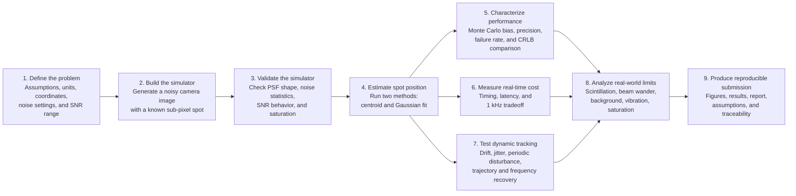

# Methodology flowchart

This is the high-level workflow for the project. The detailed implementation
choices, equations, assumptions, and validation checks are documented in the
main report and `plan.md`.

## What flows through the process

- **Input:** physical assumptions, sensor parameters, target SNR, and random seed.
- **Simulator output:** noisy frames plus the known true spot position.
- **Estimator output:** estimated sub-pixel position and quality information.
- **Static output:** bias, standard deviation, RMSE, failures, runtime, and comparison with the theoretical reference.
- **Dynamic output:** recovered trajectory and periodic disturbance frequency/amplitude.
- **Final output:** reproducible figures, machine-readable results, documented assumptions, and engineering conclusions.

