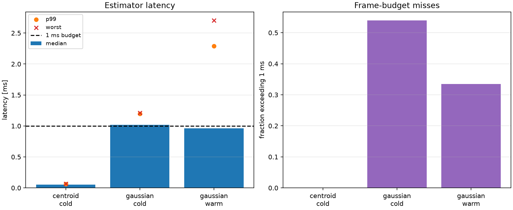

# Optional C++ Gaussian backend comparison

This document supplements the main [technical report](report.md) for the
`feature/cpp-gaussian-accelerator` branch. The main report and `results/`
remain the authoritative Python reference. This branch adds an optional C++
model/Jacobian implementation and stores its outputs separately in
`results_cpp/`.

## Reproduction

Build the optional extension from the repository root:

```bash
python -m pip install -r requirements-cpp.txt
python cpp/build_extension.py
```

Run the complete seeded comparison without overwriting the Python results:

```bash
python run_all.py \
  --config configs/cpp_gaussian.yaml \
  --results-dir results_cpp
```

The checked-in comparison snapshot is under
[`results_cpp/latest/`](results_cpp/latest/), with provenance in
[`results_cpp/latest/run_manifest.json`](results_cpp/latest/run_manifest.json).

## What was changed

The C++ extension implements the same pixel-integrated Gaussian model and
analytical seven-parameter Jacobian as the Python reference:

```text
(x0, y0, total_flux, sigma, b0, bx, by)
```

The Python estimator still performs the same ROI selection, background
initialization, variance-floor handling, IRLS passes, and bounded SciPy
Trust Region Reflective (`method="trf"`) optimization. The backend choice is
explicitly configurable:

```yaml
estimator:
  gaussian_backend: python  # reference default
  # gaussian_backend: cpp   # optional compiled model/Jacobian
```

This first branch therefore tests compiled numerical kernels without changing
the estimation algorithm or silently changing the authoritative report path.

## Numerical equivalence

The full seeded run used master seed `20260925`, the same sensor profiles,
trial counts, trajectories, and disturbance settings as the Python reference.

| Metric | Python reference | C++ model/Jacobian | Interpretation |
| --- | ---: | ---: | --- |
| Stressed SNR 10 Gaussian radial RMSE | 0.080725 px | 0.080725 px | Same accuracy to reported precision |
| Stressed SNR 1 Gaussian lock loss | 90.1% | 90.1% | Same failure classification |
| Dynamic Gaussian RMS error | 0.081718 px | 0.081718 px | Same recovered trajectory quality |
| Recovered Gaussian disturbance frequency | 72.997420 Hz | 72.997420 Hz | Same spectral result |
| Recovered Gaussian disturbance amplitude | 0.056530 px | 0.056530 px | Same amplitude result |

Across non-runtime CSV outputs, there were no discrete-result mismatches. The
largest absolute numeric difference was approximately `1.3e-8` in a derived
correlation statistic, consistent with floating-point and `erf`/normal-CDF
implementation differences.

## Runtime comparison

The measurements below are estimator-only Mac measurements from the same
200-frame, 20-warm-up benchmark. Runtime values are machine-load dependent.

| Backend | Profile | Warm median | Warm p95 | Warm p99 | Warm worst |
| --- | --- | ---: | ---: | ---: | ---: |
| Python model/Jacobian | Stressed | 1.819 ms | 2.059 ms | 2.218 ms | 2.246 ms |
| C++ model/Jacobian | Stressed | 0.960 ms | 1.369 ms | 2.290 ms | 2.705 ms |

The compiled model and Jacobian reduced the median latency by approximately
47% in this run. The p99 tail still exceeded the nominal 1 ms budget and was
affected by host load, so this is evidence of useful acceleration rather than
a deterministic real-time guarantee.



*C++ backend estimator-only runtime benchmark.*

## Validation status and next step

The branch passes 48 tests, including direct model/Jacobian equivalence and
Python-versus-C++ estimator comparisons. The default Python backend remains
unchanged and `configs/final.yaml` continues to reproduce the original
results.

The current speedup does not yet justify replacing the optimizer without
profiling on the Jetson target. The next escalation would move the complete
IRLS and nonlinear optimization loop into C++, using a solver such as Ceres
or a carefully validated fixed-size implementation. That would be a larger
algorithmic and numerical change, requiring new Jetson benchmarks and a full
comparison against this Python reference.
